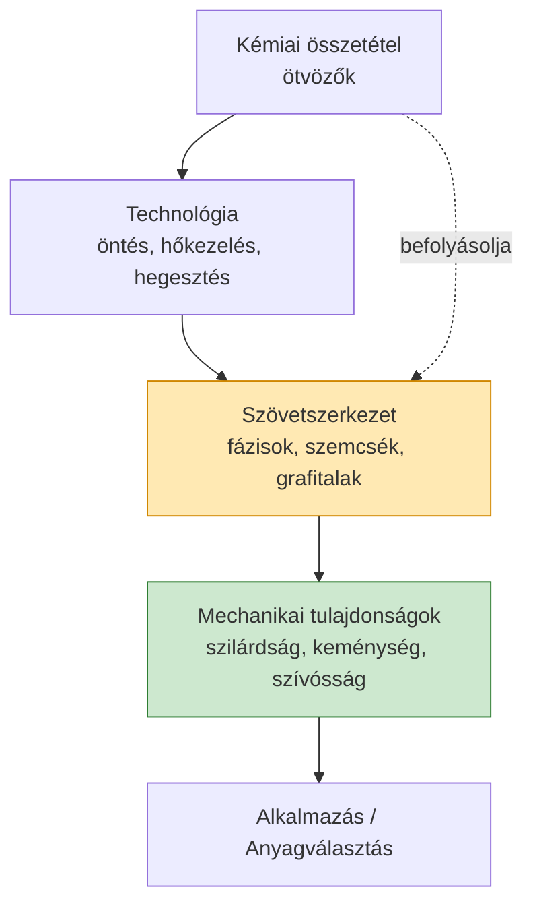

# Fémek technológiája – Vizsga-összefoglaló és tanulási útmutató

> BME · Dr. Orbulov Imre Norbert előadásai alapján összeállított, **magyar nyelvű** vizsgafelkészítő anyag.
> Minden témakörnél megtalálod: **MIT** kell tudni, **MIÉRT** úgy van, és a **💡 tipikus buktatókat** / **🔑 lényeget**.

---

## 📚 Hogyan használd ezt az anyagot?

1. **Először a nagy képet** értsd meg (ez a README + a diagramok).
2. Utána témakörönként haladj a `fejezetek/` mappában lévő fájlokon.
3. Minden fejezet végén van egy **Ellenőrző kérdések** blokk – ezekkel teszteld magad.
4. A **tanár által kiemelt kérdéseket** külön ⭐ jelöli – ezek nagy eséllyel szerepelnek a vizsgán.

> 💡 **Tanulási tipp:** ne magolj, hanem *okokat* keress. A fémek technológiájában szinte minden visszavezethető a **szövetszerkezet ↔ tulajdonság ↔ technológia** háromszögre. Ha ezt a láncot érted, bármelyik kérdést le tudod vezetni.

---

## 🗺️ Témakörök (tanulási sorrend)

| # | Fejezet | Mit tanulsz meg? |
|---|---------|------------------|
| 1 | [Alapfogalmak: ötvözetek, fázisok, szövetelemek](fejezetek/01-alapfogalmak.md) | Fázis, komponens, szövetelem, a vas-szén diagram olvasása |
| 2 | [A vas–szén állapotábra](fejezetek/02-vas-szen-diagram.md) | Ferrit, ausztenit, perlit, cementit, ledeburit; eutektoidos átalakulás |
| 3 | [Hőkezelések: lágyítás, normalizálás, edzés, megeresztés](fejezetek/03-hokezelesek.md) | ⭐ **Edzés feltételei**, Jominy-próba, átedzhetőség |
| 4 | [Ötvözők hatása az acélok tulajdonságaira](fejezetek/04-otvozok-hatasa.md) | Karbid-, ferrit-, ausztenitképzők; átedzhető szelvény |
| 5 | [Acélok csoportosítása és jelölése](fejezetek/05-acelok-csoportositasa.md) | ⭐ **Schaeffler-diagram**, korrózióálló/ötvözött acélok |
| 6 | [Öntöttvasak](fejezetek/06-ontottvasak.md) | Lemez-, gömb-, temper grafit; a grafitalak hatása |
| 7 | [Nyersvas- és acélgyártás](fejezetek/07-nyersvas-es-acelgyartas.md) | Nagyolvasztó, konverter, elektroacél, folyamatos öntés |
| 8 | [Öntészet és porkohászat](fejezetek/08-onteszet-porkohaszat.md) | Formázás, öntési hibák, szinterelés |
| 9 | [Hegesztés – áttekintés és ömlesztő eljárások](fejezetek/09-hegesztes-attekintes.md) | Hegesztések felosztása, ív-, gáz-, fedett ívű hegesztés |
| 10 | [Hegesztés – sajtoló (ellenállás) eljárások](fejezetek/10-hegesztes-sajtolo.md) | ⭐ **Ellenállási ponthegesztés** (rajzzal) |
| 11 | [Anyag- és technológiaválasztás](fejezetek/11-anyagvalasztas.md) | ⭐ **Anyagválasztás menete** (pl. kovácssüllyeszték) |

---

## ⭐ A tanár által kiemelt vizsgakérdések (KÖTELEZŐ!)

A tanár az órán kiemelte, hogy ezek **nagy valószínűséggel vizsgakérdések**. Mindegyikhez külön, részletes levezetést találsz:

1. **Edzés feltételei** → [3. fejezet](fejezetek/03-hokezelesek.md#-edzes-feltetelei-tanar-altal-kiemelt-kerdes)
2. **Schaeffler-diagram** → [5. fejezet](fejezetek/05-acelok-csoportositasa.md#-schaeffler-diagram-tanar-altal-kiemelt-kerdes)
3. **Anyagválasztás menete** (adott alkatrészhez, pl. kovácssüllyeszték) → [11. fejezet](fejezetek/11-anyagvalasztas.md#-az-anyagvalasztas-menete-tanar-altal-kiemelt-kerdes)
4. **Alapvető hegesztések, esetleg rajzzal** (pl. ellenállási ponthegesztés) → [10. fejezet](fejezetek/10-hegesztes-sajtolo.md#-ellenallasi-ponthegesztes-tanar-altal-kiemelt-kerdes-rajzzal)

---

## 🔑 A teljes tárgy egy ábrán – a központi gondolat



> 🔑 **A tárgy lényege egy mondatban:** az **összetétel** és a **technológia** (hűtési sebesség, deformáció, hőkezelés) együtt határozzák meg a **szövetszerkezetet**, a szövetszerkezet pedig a **tulajdonságokat** – vizsgán szinte mindig valamelyik nyíl mentén kell érvelned.

---

## 📂 Repó-struktúra

```
.
├── README.md                 ← ezt olvasod
├── fejezetek/                ← a 11 témakör részletesen
├── abrak/                    ← saját készítésű SVG ábrák
└── keplettar.md              ← összes képlet egy helyen (gyors ismétléshez)
```

---

*Készült tanulási célra, az előadásanyagok tartalmi összefoglalásaként. Az ábrák saját készítésűek, a jobb megjeleníthetőség érdekében SVG/Mermaid formátumban.*
