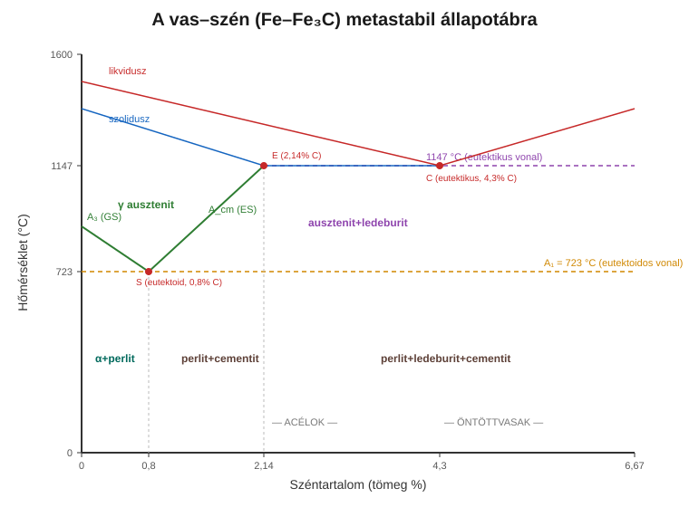

# 2. A vas–szén állapotábra

[⬅️ Vissza a tartalomjegyzékhez](../README.md)

---

## 🎯 Mit kell tudni?

A vas–szén diagram a **teljes tárgy gerince**. Ha ezt olvasni tudod, az acélok, öntöttvasak, hőkezelések nagy részét le tudod vezetni belőle. A vizsgán gyakran kérik: *rajzold fel és magyarázd el*.

> Az ábra a **metastabil** Fe–Fe₃C rendszer (a gyakorlatban ez a releváns). A stabil Fe–grafit rendszer hasonló, de a szén grafitként válik ki – ez az öntöttvasaknál lesz fontos (6. fejezet).

---

## 2.1 A két vastípus (allotróp módosulatok)

A vas hőmérséklettől függően **más-más rácsszerkezetet** vesz fel – ez a kulcs mindenhez:

| Módosulat | Rács | Hőmérséklet-tartomány | Max. oldott szén |
|-----------|------|-----------------------|------------------|
| **α-vas (ferrit)** | BCC (térben középpontos köbös) | szobahő – 911 °C | **0,02 %** (723 °C-on) |
| **γ-vas (ausztenit)** | FCC (felületen középpontos köbös) | 911 – 1392 °C | **2,14 %** (1147 °C-on) |
| δ-vas | BCC | 1392 °C – olvadás | kevés |

> 🔑 **A legfontosabb összefüggés:** az FCC ausztenit **sokkal több szenet old** (2,14% vs 0,02%). Hűtéskor a szénnek "ki kell jönnie" az oldatból → ez okozza a perlit kiválását (lassú hűtés) vagy a martenzit-képződést (gyors hűtés).

---

## 2.2 A fontos fázisok és szövetelemek

| Megnevezés | Mi ez? | Jellemző |
|------------|--------|----------|
| **Ferrit (α)** | szilárd oldat (vas + kevés C) | lágy, jól alakítható |
| **Ausztenit (γ)** | szilárd oldat (vas + sok C) | csak magas hőmérsékleten stabil |
| **Cementit (Fe₃C)** | intersztíciós vegyület, 6,67% C | **nagyon kemény, rideg** |
| **Perlit** | szövetelem: ferrit + cementit lemezek (0,8% C) | eutektoidos bomlásból |
| **Ledeburit** | szövetelem: ausztenit + cementit (4,3% C) | eutektikus, öntöttvasakban |

---

## 2.3 A nevezetes pontok és vonalak

- **A₁ (723 °C) – eutektoidos vonal:** itt megy végbe az eutektoidos átalakulás.
- **A₃ vonal (GS):** itt kezd a ferrit kiválni az ausztenitből (hűtéskor) – az edzéshez e fölé kell hevíteni (lásd 3. fejezet).
- **A_cm vonal (ES):** itt kezd a (szekunder) cementit kiválni az ausztenitből.
- **S pont (0,8% C, 723 °C):** eutektoidos pont.
- **E pont (2,14% C):** ez választja el az **acélokat** (< 2,14% C) az **öntöttvasaktól** (> 2,14% C).
- **C pont (4,3% C):** eutektikus pont.

> 💡 **Buktató / vizsgahatár:** **acél = 2,14% C alatt, öntöttvas = 2,14% C felett.** Ezt a 2,14%-ot (E pont) a vizsgán tudni kell – ez az acél és öntöttvas közti határ oka: eddig oldódik a szén az ausztenitben.

---

## 2.4 Az eutektoidos átalakulás (a legfontosabb reakció)

Lassan hűtve, **0,8% C**-nál és **723 °C**-on:

$$\gamma \;\longrightarrow\; \alpha + \mathrm{Fe_3C}$$

ahol az összetételek: $\gamma$ (0,8% C) $\rightarrow$ $\alpha$ (0,02% C) + $\mathrm{Fe_3C}$ (6,67% C).

Vagyis az ausztenit egyszerre bomlik **ferritre + cementitre**, és ezek finom lemezekként egymás mellé rendeződnek → ez a **perlit**.

A széntartalom szerint három acélcsoport:

- **Eutektoidos acél (0,8% C):** szövete tiszta perlit.
- **Alperekrites / hipoeutektoidos (< 0,8% C):** ferrit + perlit.
- **Túleutektoidos / hipereutektoidos (0,8–2,14% C):** perlit + (szekunder) cementit a szemcsehatárokon.

> 🔑 **Tendencia, amit tudni kell:** több szén → több kemény cementit → **nagyobb keménység/szilárdság, de kisebb szívósság** (ridegebb). Ez végigvonul az egész tárgyon.

---

## ✅ Ellenőrző kérdések

1. Rajzold fel vázlatosan a Fe–Fe₃C diagramot és jelöld az S, E, C pontokat!
2. Mi az eutektoidos reakció egyenlete, és milyen szövet keletkezik?
3. Hány %-nál van az acél/öntöttvas határ, és miért pont ott?
4. Miért old az ausztenit több szenet, mint a ferrit?
5. Mi a különbség a perlit és a ledeburit között?

🔎 Válaszok

1. Lásd a fenti ábrát; S = 0,8% C / 723 °C, E = 2,14% C, C = 4,3% C.
2. γ → α + Fe₃C (723 °C-on, 0,8% C-nál); a keletkező szövet a **perlit**.
3. 2,14% C-nál (E pont), mert eddig oldódik a szén az ausztenitben.
4. Az FCC rács nagyobb rácsüregei miatt (több hely az intersztíciós szénnek).
5. A perlit eutektoidos (ferrit+cementit, 0,8% C), a ledeburit eutektikus (ausztenit+cementit, 4,3% C, öntöttvasban).

---

[⬅️ Előző](01-alapfogalmak.md) · [Következő ➡️](03-hokezelesek.md)
