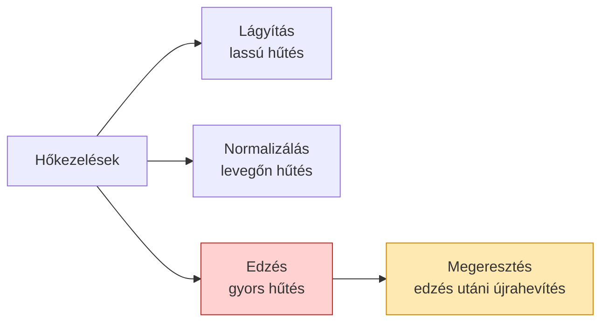
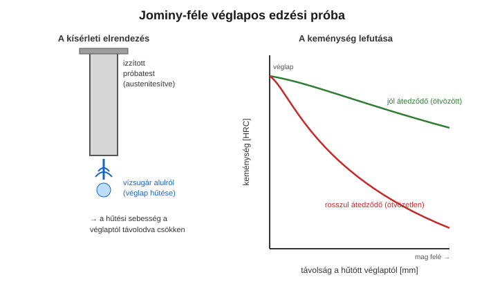

# 3. Hőkezelések: lágyítás, normalizálás, edzés, megeresztés

[⬅️ Vissza a tartalomjegyzékhez](../README.md)

---

## 🎯 Mit kell tudni?

A hőkezelés = az **összetétel változtatása nélkül** a szövetszerkezet (és így a tulajdonságok) célzott módosítása **hevítéssel, hőntartással és hűtéssel**. Itt van a tanár által kiemelt ⭐ **edzés feltételei** kérdés is.

> 🔑 **Minden hőkezelés három lépés:** (1) **hevítés** adott hőmérsékletre, (2) **hőntartás** (hogy a szövet átalakuljon/homogenizálódjon), (3) **hűtés** adott sebességgel. A három közül a **hűtési sebesség** a legdöntőbb a végső szövetre.

---

## 3.1 A hőkezelések áttekintése

| Eljárás | Cél | Hűtés | Eredmény |
|---------|-----|-------|----------|
| **Lágyítás** | puhítás, megmunkálhatóság, feszültségmentesítés | nagyon lassú (kemencében) | durva, lágy szövet |
| **Normalizálás** | finomszemcsés, egyenletes szövet | nyugodt levegőn | finom ferrit+perlit |
| **Edzés** | **nagy keménység/szilárdság** | gyors (víz, olaj) | **martenzit** |
| **Megeresztés** | a rideg edzett acél szívósítása | edzés után hevítés A₁ alá | megeresztett szövet |

---

## ⭐ Edzés feltételei (TANÁR ÁLTAL KIEMELT KÉRDÉS!)

> Ez a tanár szerint **vizsgakérdés lehet** – tanuld meg pontosan, levezetéssel!

Az **edzés** célja a kemény, nem egyensúlyi **martenzit** szövet előállítása. Ehhez **három feltétel** egyszerre kell:

### 1️⃣ Megfelelő széntartalom (anyagfeltétel)

- Az acélnak **≥ ~0,3% szenet** kell tartalmaznia, hogy az edzésnek értelme legyen (érdemi keménységnövekedés).
- **MIÉRT?** A martenzit keménységét a benne "beragadt" **túltelített szén** okozza. Ha kevés a szén, a martenzit is lágy marad – nincs mit beszorítani a rácsba. Ezért a **lágyacélok (< 0,2% C) nem edzhetők** érdemben.

### 2️⃣ Megfelelő hevítési hőmérséklet → **teljes ausztenitesítés**

- Az acélt az **A₃ (hipoeutektoidos) ill. A₁ (túleutektoidos) vonal fölé** kell hevíteni, hogy **teljesen ausztenitessé** váljon (a szén teljesen oldatba menjen).
- **MIÉRT?** Csak az ausztenitből (FCC, sok oldott szén) tud a gyors hűtés martenzitet csinálni. Ha nincs ausztenit, nincs martenzit.
- 💡 **Buktató:** túl magas hőmérséklet → **szemcsedurvulás** (rossz szívósság). A hőmérsékletet tehát pontosan kell eltalálni: épp a kritikus vonal fölé (~30–50 °C-kal).

### 3️⃣ Megfelelő (kritikusnál nagyobb) hűtési sebesség

- A hűtésnek **gyorsabbnak kell lennie a kritikus hűtési sebességnél**, hogy a szén ne tudjon kidiffundálni (ne keletkezzen perlit), hanem a rács "diffúzió nélkül", nyírással alakuljon át → **martenzit**.
- **MIÉRT?** A martenzit átalakulása **diffúzió nélküli** (athermikus): a szén beszorul a rácsba, azt torzítja (tetragonálissá teszi) → innen a nagy keménység. Ha lassan hűtünk, a szénnek van ideje kidiffundálni → perlit lesz, nem martenzit.
- A kritikus hűtési sebesség **ötvözéssel csökkenthető** → ezért edzhetők az ötvözött acélok olajban/levegőn is (lásd 4. fejezet, átedzhetőség).

> 🔑 **Összefoglalva – az edzés 3 feltétele egy mondatban:**
> **(1) elég szén (≥~0,3% C), (2) teljes ausztenitesítés (A₃/A₁ fölé hevítés), (3) a kritikusnál gyorsabb hűtés.** Ha bármelyik hiányzik, nem (vagy nem jól) keletkezik martenzit.

---

## 3.2 A martenzit

- **Túltelített** szilárd oldat: az ausztenit szénben dús rácsa gyors hűtéskor **diffúzió nélkül** torzult (tetragonális, BCT) rácsba ugrik.
- **Nagyon kemény, de rideg.** Ezért edzés után szinte mindig **megeresztés** következik.
- Tűs/lemezes szövet.

---

## 3.3 Megeresztés

Az edzett (martenzites) acélt **A₁ alá** (kb. 150–650 °C) hevítjük, majd hűtjük.

- **Cél:** a rideg martenzit **szívósítása**, a belső feszültségek oldása.
- **Következmény:** a keménység kissé csökken, de a **szívósság jelentősen nő**.
- Alacsony megeresztés → kemény, kissé szívósabb; magas megeresztés → lágyabb, nagyon szívós (nemesítés = edzés + magas megeresztés).

> 💡 **Nemesítés** = **edzés + magas hőmérsékletű megeresztés**. Ez ad kedvező szilárdság–szívósság kombinációt (szerkezeti acéloknál tipikus).

---

## 3.4 Jominy-próba (átedzhetőség mérése)

A **Jominy-féle véglapos próba** méri, milyen mélyen edződik át egy acél.

- Az ausztenitesített hengeres próbatestet a **véglapjánál** vízsugárral hűtik.
- A véglaptól távolodva a **hűtési sebesség csökken** → a keménység is változik.
- A keménység-távolság görbe megmutatja az **átedzhetőséget**: minél laposabb a görbe, annál mélyebben (nagyobb szelvényben) edződik át az acél.

> 🔑 Az **ötvözött** acél görbéje laposabb (mélyen átedződik), az **ötvözetlen** acélé meredeken esik (csak a felszín edződik). Ennek oka a 4. fejezetben: az ötvözők csökkentik a kritikus hűtési sebességet.

---

## ✅ Ellenőrző kérdések

1. ⭐ Mi az edzés **három feltétele**, és mindegyiknél MIÉRT kell teljesülnie?
2. Miért nem edzhető a lágyacél (< 0,2% C)?
3. Mi a martenzit, és miért kemény?
4. Mi a megeresztés célja, és mi a nemesítés?
5. Mit mér a Jominy-próba, és hogyan olvasod le az átedzhetőséget?

🔎 Válaszok

1. (1) Elég szén (≥~0,3% C) – kell a túltelítéshez; (2) teljes ausztenitesítés (A₃/A₁ fölé) – csak ausztenitből lesz martenzit; (3) kritikusnál gyorsabb hűtés – hogy a szén ne diffundáljon ki (ne perlit legyen).
2. Kevés szén → a martenzit sem lesz kemény (nincs mit a rácsba beszorítani).
3. Túltelített, torzult (tetragonális) szilárd oldat; a beszorult szén torzítja a rácsot → nagy keménység.
4. A megeresztés a rideg martenzitet szívósítja (A₁ alatti hevítés); a nemesítés = edzés + magas megeresztés (jó szilárdság–szívósság).
5. Az átedzhetőséget (milyen mélyen edződik); laposabb keménység-távolság görbe = mélyebb átedzhetőség.

---

[⬅️ Előző](02-vas-szen-diagram.md) · [Következő ➡️](04-otvozok-hatasa.md)
