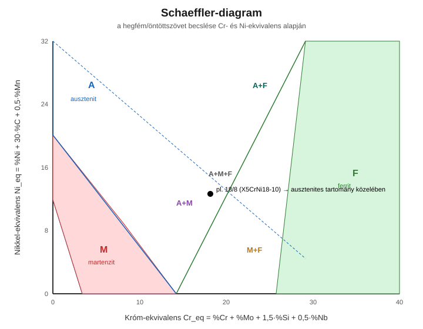

# 5. Acélok csoportosítása és jelölése

[⬅️ Vissza a tartalomjegyzékhez](../README.md)

---

## 🎯 Mit kell tudni?

Hogyan csoportosítjuk az acélokat, hogyan jelöljük őket, és hogyan használjuk a tanár által kiemelt ⭐ **Schaeffler-diagramot** a hegfém szövetének becslésére.

---

## 5.1 Az acélok csoportosítása

**Széntartalom szerint** (lásd 2. fejezet): hipoeutektoidos (< 0,8% C), eutektoidos (0,8% C), hipereutektoidos (> 0,8% C).

**Ötvözöttség szerint:**

| Csoport | Jellemző |
|---------|----------|
| **Ötvözetlen (szén)acél** | csak kísérő elemek + szén |
| **Gyengén ötvözött** | ötvözők összege < ~5% |
| **Erősen ötvözött** | legalább egy ötvöző ≥ ~5% (pl. korrózióálló, szerszámacélok) |

**Felhasználás szerint:** szerkezeti, betéredzésű, nemesíthető, szerszám-, rozsdamentes, melegszilárd acélok stb.

---

## 5.2 Acéljelölések (EN rendszer – a lényeg)

- **Ötvözetlen szerkezeti acél:** `S235`, `S355` → az **S** = szerkezeti (structural), a szám a **minimális folyáshatár** N/mm²-ben.
- **Ötvözetlen minőségi/C-acél:** `C45` → a szám a **széntartalom ×100** (tehát 0,45% C).
- **Gyengén ötvözött:** `42CrMo4` → `42` = C×100 (0,42% C), majd az ötvözők (`Cr`, `Mo`), a végén a fő ötvöző mennyisége osztószámmal.
- **Erősen ötvözött:** `X` előtag, pl. `X5CrNi18-10` → `X` = erősen ötvözött, `5` = C×100 (0,05% C), `18% Cr`, `10% Ni` (a klasszikus "18/8" rozsdamentes).

> 💡 **Buktató:** a `C45`-nél a 45 **nem** a folyáshatár, hanem a **széntartalom** (0,45%). Az `S235`-nél viszont **folyáshatár** (235 MPa). A betű dönti el, melyik!

---

## 5.3 Korrózióálló (rozsdamentes) acélok

A korrózióállóság kulcsa: **≥ ~12% Cr**, ami passzív, tömör **króm-oxid réteget** képez a felületen.

| Típus | Szövet | Jellemző |
|-------|--------|----------|
| **Ferrites** | ferrit | mágneses, nem edzhető, olcsóbb (kevés/nincs Ni) |
| **Martenzites** | martenzit | edzhető, kemény (kés, csapágy), kissé kevésbé korrózióálló |
| **Ausztenites** | ausztenit | nem mágneses, jól hegeszthető, legkorrózióállóbb (18/8 Cr-Ni) |
| **Duplex** | ferrit + ausztenit | nagy szilárdság + jó korrózióállóság |

---

## ⭐ Schaeffler-diagram (TANÁR ÁLTAL KIEMELT KÉRDÉS!)

> Ez a tanár szerint **vizsgakérdés lehet** – értsd meg, mire jó, és hogyan használod!

### Mire jó?

A Schaeffler-diagram segítségével megbecsülhető, hogy egy **nagyötvözött acél hegfémének** (vagy öntött szövetének) **milyen szövetszerkezete** lesz gyors hűtés után: **ausztenit (A)**, **ferrit (F)**, **martenzit (M)** vagy ezek keverékei.

### Hogyan használjuk? (a módszer lépésről lépésre)

1. **Számítsd ki a króm-ekvivalenst** (a ferritképzők összege):

$$Cr_{eq} = \%Cr + \%Mo + 1{,}5\cdot\%Si + 0{,}5\cdot\%Nb$$

2. **Számítsd ki a nikkel-ekvivalenst** (az ausztenitképzők összege):

$$Ni_{eq} = \%Ni + 30\cdot\%C + 0{,}5\cdot\%Mn$$

3. **Vízszintes tengely = Cr_eq, függőleges = Ni_eq.** Mérd fel a pontot.
4. **Olvasd le a tartományt**, amelybe a pont esik (A / F / M / kevert) → ez a várható szövet.

> 🔑 **A diagram logikája:** a **ferritképzők** (Cr, Mo, Si, Nb) jobbra visznek (ferrit felé), az **ausztenitképzők** (Ni, C, Mn) felfelé (ausztenit felé). A szén súlya nagy (×30 a Ni-ekvivalensben), mert erős ausztenitstabilizáló.

> 💡 **Tipikus vizsgafeladat:** adott összetételű acélra számítsd ki a Cr_eq és Ni_eq értéket, jelöld be a pontot, és mondd meg a várható szövetet. A klasszikus **18/8** (X5CrNi18-10) az **ausztenites** tartományba (esetleg kevés δ-ferrittel a hegfémben) esik.

> 💡 **Hegesztési jelentőség:** a hegfémben kevés **δ-ferrit (~5–10%)** kedvező, mert csökkenti a melegrepedés-hajlamot. A diagrammal ez a ferrittartalom megbecsülhető és beállítható a huzal/összetétel megválasztásával.

---

## ✅ Ellenőrző kérdések

1. Mit jelent az `S355`, a `C45` és az `X5CrNi18-10` jelölés?
2. Hány % Cr kell a korrózióállósághoz, és miért pont a Cr?
3. ⭐ Mire jó a Schaeffler-diagram, és mi a két tengelye?
4. ⭐ Hogyan számolod a Cr- és Ni-ekvivalenst?
5. Miért kedvező kevés δ-ferrit az ausztenites acél hegfémében?

🔎 Válaszok

1. S355: szerkezeti acél, 355 MPa min. folyáshatár; C45: ötvözetlen, 0,45% C; X5CrNi18-10: erősen ötvözött, 0,05% C, 18% Cr, 10% Ni (ausztenites rozsdamentes).
2. ≥~12% Cr; passzív, tömör króm-oxid réteget képez.
3. A hegfém/öntött szövet (A/F/M) becslésére; tengelyei a Cr-ekvivalens (x) és a Ni-ekvivalens (y).
4. Cr_eq = %Cr + %Mo + 1,5·%Si + 0,5·%Nb; Ni_eq = %Ni + 30·%C + 0,5·%Mn.
5. Csökkenti a melegrepedési hajlamot.

---

[⬅️ Előző](04-otvozok-hatasa.md) · [Következő ➡️](06-ontottvasak.md)
