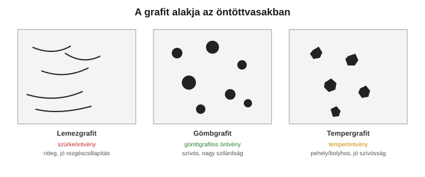

# 6. Öntöttvasak

[⬅️ Vissza a tartalomjegyzékhez](../README.md)

---

## 🎯 Mit kell tudni?

Mi különbözteti meg az öntöttvasat az acéltól, miért olcsó és jól önthető, és **miért döntő a grafit alakja** a tulajdonságokra.

---

## 6.1 Mi az öntöttvas?

- **Öntöttvas = > 2,14% C** (gyakorlatban 2,5–4% C) vas-szén ötvözet (lásd 2. fejezet, E pont).
- A sok szén miatt **alacsony az olvadáspontja** és **kiváló az önthetősége**, de **nem alakítható** (nem kovácsolható) – kizárólag öntéssel dolgozzák fel.
- A szén részben/egészben **grafitként** válik ki (stabil rendszer) vagy **cementitként** (metastabil → fehér öntöttvas).

> 🔑 **Az öntöttvas lényege:** a nagy széntartalom → olcsó, jól önthető, de rideg(ebb) és nem alakítható. A szén **megjelenési formája** (grafit vagy cementit, és a grafit *alakja*) dönti el a tulajdonságokat.

---

## 6.2 A grafit alakjának hatása

| Öntöttvas | Grafitalak | Tulajdonság | MIÉRT? |
|-----------|-----------|-------------|--------|
| **Szürkeöntvény (lemezgrafitos)** | éles szélű **lemezek** | rideg, kis szakítószilárdság, de jó **nyomószilárdság**, kiváló **rezgéscsillapítás**, jó megmunkálhatóság | a lemezek **éles végei feszültséggyűjtők** (berepedésindítók) → rideg |
| **Gömbgrafitos öntvény** | **gömbök** | **szívós**, nagy szilárdság, nyúlik | a gömb alaknak nincs éles bemetszése → nem indít repedést |
| **Temperöntvény** | **pehely/bolyhos** (hőkezeléssel) | jó szívósság | fehér öntvény hőkezelésével (temperálás) a cementit grafittá bomlik |

> 🔑 **A legfontosabb tanulság:** ugyanaz az alapanyag (vas + szén), de a **grafit alakja** gyökeresen más tulajdonságot ad. A **lemez** éles vége feszültséggyűjtő (rideg), a **gömb** nem (szívós). Vizsgán ezt az okot kérik!

> 💡 **Gömbgrafit hogyan jön létre?** Olvadékkezeléssel: **magnéziummal (Mg)** oltanak, ami gömbösíti a grafitot. A szürkeöntvényhez képest ez jelentősen növeli a szilárdságot és szívósságot.

---

## 6.3 Fehér és szürke öntöttvas

- **Fehér öntöttvas:** a szén **cementitként** van jelen (gyors hűtés, kevés Si) → nagyon kemény, rideg, kopásálló, de rosszul megmunkálható. Törési felülete fényes-fehér.
- **Szürke öntöttvas:** a szén **grafitként** válik ki (lassabb hűtés, több Si) → törési felülete szürke (a grafittól).
- A **szilícium grafitosító** hatású: segíti a grafit kiválását (a stabil rendszer felé tol).

---

## 6.4 Jelölés (EN, a lényeg)

- **Lemezgrafitos (szürke):** `EN-GJL-250` → `GJL` = grafit, lemezes (Lamellar); a szám a min. szakítószilárdság.
- **Gömbgrafitos:** `EN-GJS-400-15` → `GJS` = gömbös (Spheroidal); szilárdság + nyúlás %.
- **Temper:** `EN-GJMW` / `EN-GJMB` (fehér/fekete szívmagú temper).

---

## ✅ Ellenőrző kérdések

1. Hány % szén felett beszélünk öntöttvasról, és miért nem alakítható?
2. Miért rideg a lemezgrafitos öntvény, és miért szívós a gömbgrafitos?
3. Hogyan állítható elő a gömbgrafit?
4. Mi a különbség a fehér és a szürke öntöttvas között? Mi a szilícium szerepe?
5. Mit jelent az `EN-GJS-400-15` jelölés?

🔎 Válaszok

1. > 2,14% C felett; a sok szén/grafit miatt rideg, nem alakítható (csak önthető).
2. A lemezek éles vége feszültséggyűjtő (repedésindító) → rideg; a gömbnek nincs éles bemetszése → szívós.
3. Olvadékkezeléssel, magnéziumos (Mg) oltással.
4. Fehér: szén cementitként (kemény, rideg); szürke: szén grafitként. A Si grafitosító (segíti a grafit kiválását).
5. Gömbgrafitos öntvény, 400 MPa min. szakítószilárdság, 15% nyúlás.

---

[⬅️ Előző](05-acelok-csoportositasa.md) · [Következő ➡️](07-nyersvas-es-acelgyartas.md)
