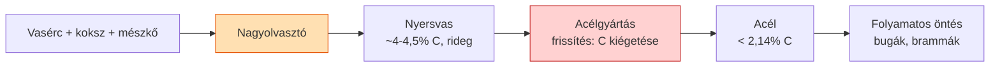

# 7. Nyersvas- és acélgyártás

[⬅️ Vissza a tartalomjegyzékhez](../README.md)

---

## 🎯 Mit kell tudni?

Hogyan lesz az ércből acél? A folyamat logikáját kell értened: **érc → nyersvas (sok C) → acél (kevesebb C) → öntés**.

---

## 7.1 A teljes folyamat áttekintése

> 🔑 **A kulcsgondolat:** a nagyolvasztóból jövő **nyersvasban túl sok a szén** (~4%, rideg). Az acélgyártás lényege a **frissítés** = a felesleges **szén és szennyezők kiégetése oxigénnel**, hogy acélt (< 2,14% C) kapjunk.

---

## 7.2 Nagyolvasztó (nyersvasgyártás)

- Betét: **vasérc** (oxidok), **koksz** (tüzelő + redukáló), **mészkő** (salakképző).
- A koksz égése CO-t ad, ami **redukálja** a vasoxidokat: $\mathrm{Fe_2O_3 + 3CO \rightarrow 2Fe + 3CO_2}$.
- A mészkő a meddővel **salakot** képez (ez elválasztja a szennyezőt a vastól).
- Terméke a **nyersvas** (~4–4,5% C, sok P, S, Si, Mn) – rideg, csak öntöttvasnak vagy acélgyártás alapanyagának jó.

> 💡 A koksznak **kettős szerepe** van: tüzelőanyag (hő) ÉS redukálószer (a CO révén). Ezt gyakran kérdezik.

---

## 7.3 Acélgyártás (frissítés)

A cél: a nyersvas széntartalmát és szennyezőit **csökkenteni** oxidációval.

| Eljárás | Lényeg |
|---------|--------|
| **Oxigénes konverter (LD)** | folyékony nyersvasba **tiszta oxigént** fúvatnak → a C, Si, Mn, P kiég; gyors, nagy tételek |
| **Elektroacélgyártás (ívkemence)** | főleg **acélhulladékból**, villamos ívvel olvasztva; jól szabályozható, ötvözött/minőségi acélokhoz |

- A frissítés során **dezoxidálni** kell (az oldott oxigént megkötni) – pl. Si, Mn, Al hozzáadásával → "csillapított" (nyugtatott) acél.
- **Salakmetallurgia / üstmetallurgia:** finom összetétel-beállítás, kéntelenítés az üstben.

> 💡 **Buktató:** a konverterben **nem fűtenek** – a szén és a szennyezők **égése maga ad hőt** (exoterm folyamat). Ezért kell hulladékot (hűtő adalékot) is adagolni a hőmérséklet szabályozására.

---

## 7.4 Folyamatos (kontinuus) öntés

- A kész folyékony acélt **folyamatosan öntik** vízhűtéses kristályosítón át → félkész termék: **buga, bramma, előgyártmány**.
- Felváltotta a régi tuskóöntést: jobb kihozatal, egyenletesebb minőség.

---

## 7.5 Acélhibák eredete

- **Zárványok** (oxidok, szulfidok), **gázporozitás**, **dúsulás (szegregáció)** – ezek a gyártásból öröklődő hibák, amelyek rontják a mechanikai tulajdonságokat.
- A tisztább gyártás (üstmetallurgia, vákuumkezelés) ezeket csökkenti.

---

## ✅ Ellenőrző kérdések

1. Mi a nagyolvasztó betéte, és mi a koksz kettős szerepe?
2. Miért kell a nyersvasat "frissíteni"? Mit jelent ez?
3. Mi a különbség a konverteres és az elektroacélgyártás között?
4. Honnan jön a hő az oxigénes konverterben?
5. Mi a folyamatos öntés előnye?

🔎 Válaszok

1. Vasérc + koksz + mészkő; a koksz tüzelőanyag ÉS redukálószer (CO révén).
2. Mert a nyersvasban túl sok a C és a szennyező; a frissítés = ezek kiégetése oxigénnel → acél.
3. Konverter: folyékony nyersvasból, oxigénbefúvással, nagy tömeg; elektroacél: főleg hulladékból, ívkemencében, jól szabályozható, ötvözött acélokhoz.
4. A szén és szennyezők égéséből (exoterm), ezért hulladékkal hűtik.
5. Jobb kihozatal, egyenletesebb minőség (a tuskóöntéshez képest).

---

[⬅️ Előző](06-ontottvasak.md) · [Következő ➡️](08-onteszet-porkohaszat.md)
