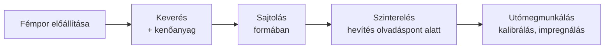

# 8. Öntészet és porkohászat

[⬅️ Vissza a tartalomjegyzékhez](../README.md)

---

## 🎯 Mit kell tudni?

Az **öntészet** (alakadás folyékony fémből) alapfogalmai és tipikus hibái, valamint a **porkohászat** (alakadás fémporból) logikája és előnyei.

---

## 8.1 Öntészet – az alapgondolat

Az **öntés** = a folyékony fémet **formaüregbe** öntjük, ahol megdermedve felveszi a kívánt alakot. Bonyolult, üreges alkatrészek egy lépésben gyárthatók.

**A folyamat fő elemei:**

- **Minta (modell):** az öntvény alakját adó segédeszköz (a formázáshoz).
- **Forma:** a mintáról készített negatív üreg (homokforma vagy fémforma/kokilla).
- **Mag:** a belső üregeket képező betét.
- **Beömlő- és tápláló rendszer:** a fém bevezetésére és a zsugorodás pótlására.

---

## 8.2 Formázási eljárások

| Eljárás | Jellemző |
|---------|----------|
| **Homokformázás** | eldobható forma, olcsó, nagy darabokhoz; durvább felület |
| **Kokillaöntés** | tartós fémforma, jó felület, sorozatgyártás |
| **Nyomásos öntés** | a fémet **nagy nyomással** sajtolják a formába; pontos, vékony falú darabok (pl. alumínium) |
| **Precíziós (viaszveszejtéses)** | kiolvasztható viaszminta → nagyon pontos, bonyolult darabok |

---

## 8.3 Öntési hibák (a dermedés fizikájából)

> 🔑 **A legtöbb öntési hiba oka a zsugorodás és a gázok.** A fém dermedéskor **összehúzódik** – ha ezt nem pótoljuk (táplálás), üreg marad.

| Hiba | Ok |
|------|-----|
| **Lunker (szívódási üreg)** | a dermedéskori zsugorodást nem pótolja a tápfej → belső/külső üreg |
| **Gázporozitás (likacs)** | a fémben oldott gázok dermedéskor kiválnak |
| **Hidegfolyás** | a fém túl korán dermed, nem tölti ki a formát |
| **Salak-/homokzárvány** | idegen anyag kerül az öntvénybe |
| **Melegrepedés** | a dermedés közbeni feszültség repeszt |

> 💡 **Táplálás (tápfej):** szándékosan a legvastagabb résznél helyezik el, hogy **utoljára dermedjen**, és onnan pótolja a zsugorodást → a lunker a tápfejbe (hulladékba) kerül, nem az alkatrészbe.

---

## 8.4 Porkohászat (PM – powder metallurgy)

Alakadás **fémporból**, olvasztás nélkül (vagy csak részleges olvadással).

**A folyamat lépései:**

1. **Porgyártás** (porlasztás, redukció stb.).
2. **Sajtolás (préselés):** a port szerszámban nyers ("zöld") testté tömörítik.
3. **Szinterelés:** az olvadáspont **alatti** hőmérsékleten hevítve a porszemcsék **összehegednek** (diffúzióval), a test szilárdságot nyer.
4. **Utómegmunkálás:** kalibrálás, olajimpregnálás stb.

> 🔑 **A szinterelés lényege:** NEM olvad meg a fém – a szemcsék a **felületi diffúzió** révén nőnek össze, a pórusok részben bezáródnak. Ezért marad a termékben gyakran **maradó porozitás** (ami lehet hasznos is, pl. önkenő csapágy).

### Mikor éri meg a porkohászat?

- **Nehezen olvasztható / nem keverhető** anyagok (pl. keményfém WC-Co, W).
- **Nagy sorozat, bonyolult, kész méretű** kis alkatrészek (fogaskerék, csapágy) – kevés forgácsolási hulladék.
- **Szabályozott porozitás** (szűrők, önkenő csapágyak).

> 💡 **Keményfém (hard metal):** wolfram-karbid (WC) szemcsék kobalt (Co) kötőfázisban, porkohászattal – ez a forgácsoló szerszámok (lapkák) alapanyaga. Olvasztással nem gyártható.

---

## ✅ Ellenőrző kérdések

1. Mi a minta, a forma és a mag szerepe az öntésnél?
2. Mi okozza a lunkert, és hogyan védekezünk ellene?
3. Sorolj fel 3 öntési hibát és az okát!
4. Mi a szinterelés lényege? Megolvad-e a fém?
5. Mikor éri meg a porkohászat az öntés/forgácsolás helyett?

🔎 Válaszok

1. Minta: az alakot adó modell a formázáshoz; forma: a negatív üreg; mag: a belső üregeket képzi.
2. A dermedéskori zsugorodás, amit nem pótol a táplálás; védekezés: megfelelő tápfej a legvastagabb résznél.
3. Pl. lunker (zsugorodás), gázporozitás (oldott gázok), hidegfolyás (korai dermedés).
4. A porszemcsék diffúzióval összehegednek az olvadáspont alatti hevítéskor; a fém NEM olvad meg.
5. Nehezen olvasztható anyagoknál, nagy sorozatú bonyolult kis alkatrészeknél, szabályozott porozitásnál.

---

[⬅️ Előző](07-nyersvas-es-acelgyartas.md) · [Következő ➡️](09-hegesztes-attekintes.md)
