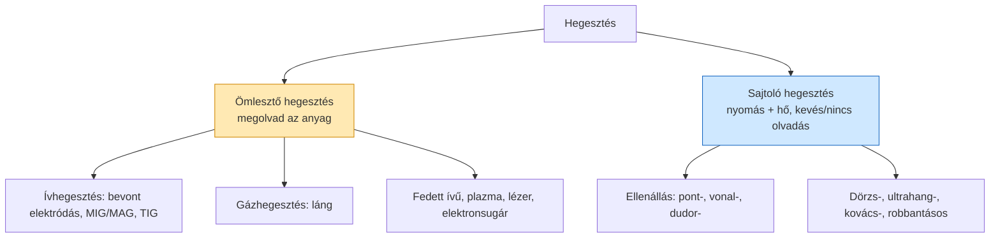

# 9. Hegesztés – áttekintés és ömlesztő eljárások

[⬅️ Vissza a tartalomjegyzékhez](../README.md)

---

## 🎯 Mit kell tudni?

A hegesztés **felosztásának logikáját** (ömlesztő vs. sajtoló), a fő ömlesztő eljárásokat, és a hegesztés metallurgiai következményeit (hőhatásövezet, repedések).

---

## 9.1 A hegesztés felosztása

> 🔑 **A fő felosztás: ömlesztő vs. sajtoló hegesztés.** Ömlesztőnél megolvad az anyag, sajtolónál nyomás (+ hő) hozza létre a kötést olvadás nélkül vagy részleges olvadással.

A **sajtoló eljárásokat** a 10. fejezet részletezi (ott van a tanár által kiemelt ⭐ ellenállási ponthegesztés).

---

## 9.2 Ömlesztő eljárások

| Eljárás | Lényeg | Jellemző |
|---------|--------|----------|
| **Bevont elektródás ívhegesztés (kézi)** | villamos ív az elektróda és munkadarab közt; a bevonat salakot/védőgázt ad | olcsó, rugalmas, lassú |
| **MIG/MAG (fogyóelektródás védőgázos)** | huzalelektróda + védőgáz (MIG: inert Ar/He; MAG: aktív CO₂) | gyors, jól automatizálható |
| **TIG (volfrámelektródás, AWI)** | nem fogyó volfrámelektróda + inert gáz, külön hozaganyag | tiszta, pontos, vékony/ötvözött anyaghoz |
| **Fedett ívű (SAW)** | por alatt égő ív, nagy teljesítmény | vastag lemez, hosszú varratok |
| **Láng- (gáz-) hegesztés** | acetilén-oxigén láng | vékony lemez, javítás, csőszerelés |

> 💡 **MIG vs MAG:** a különbség a **védőgáz**. MIG = *inert* gáz (Ar/He, pl. alumíniumhoz); MAG = *aktív* gáz (CO₂ vagy keverék, acélhoz). A betű (I/A) árulja el!

---

## 9.3 A hegesztés metallurgiai következményei

A hegesztés **helyi, intenzív hőbevitel** → a varrat környezete is átalakul.

- **Varratfém (ömledék):** megolvadt és újradermedt anyag (öntött szövet).
- **Hőhatásövezet (HHÖ / HAZ):** a varrat melletti zóna, ami nem olvadt meg, de **felhevült** → szövete megváltozik (szemcsedurvulás, esetleg beedződés).

> 🔑 **A HHÖ a leggyengébb/legkritikusabb rész!** Itt gyakran beedződik az anyag (kemény, rideg martenzit keletkezhet a gyors hűtés miatt), ami **hidegrepedésre** hajlamosít.

### Tipikus hegesztési hibák / repedések

| Hiba | Ok | Védekezés |
|------|-----|-----------|
| **Hidegrepedés** | HHÖ beedződése + hidrogén + feszültség | **előmelegítés**, kis H-tartalmú elektróda, lassú hűtés |
| **Melegrepedés** | dermedés közbeni szennyezők (S, P), feszültség | megfelelő összetétel, kevés δ-ferrit (ausztenites acélnál) |
| **Kötéshiba, beégés, porozitás** | rossz paraméter, szennyezett felület | tisztítás, helyes áram/sebesség |

> 💡 **Hegeszthetőség és a szén:** minél több a szén (és az ötvöző), annál jobban beedződik a HHÖ → **rosszabb hegeszthetőség**. Ezért a hegeszthető szerkezeti acéloknak **alacsony a széntartalma** (pl. S235, S355). Durva becslés a **szénegyenérték (CE)** – nagy CE → előmelegítés kell.

---

## ✅ Ellenőrző kérdések

1. Mi a hegesztés fő felosztása, és mi a különbség a két csoport közt?
2. Mi a különbség a MIG és a MAG között?
3. Mi a hőhatásövezet (HHÖ), és miért kritikus?
4. Mi okoz hidegrepedést, és hogyan védekezünk ellene?
5. Miért rosszabb a nagy széntartalmú acél hegeszthetősége?

🔎 Válaszok

1. Ömlesztő (megolvad az anyag) vs. sajtoló (nyomás + hő, kevés/nincs olvadás).
2. A védőgáz: MIG inert (Ar/He), MAG aktív (CO₂/keverék).
3. A varrat melletti, fel nem olvadt, de felhevült zóna; itt változik a szövet (beedződés) → repedékenység.
4. HHÖ beedződése + hidrogén + feszültség; előmelegítés, kis H-tartalmú elektróda, lassú hűtés.
5. Több szén → jobban beedződik a HHÖ (rideg martenzit) → hidegrepedés veszélye.

---

[⬅️ Előző](08-onteszet-porkohaszat.md) · [Következő ➡️](10-hegesztes-sajtolo.md)
