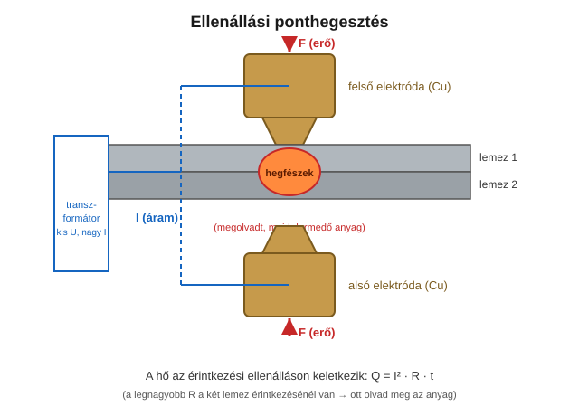

# 10. Hegesztés – sajtoló (ellenállás) eljárások

[⬅️ Vissza a tartalomjegyzékhez](../README.md)

---

## 🎯 Mit kell tudni?

A **sajtoló hegesztés** logikája (nyomás + hő), és a tanár által kiemelt ⭐ **ellenállási ponthegesztés** – amit **fel is kell tudni rajzolni**!

---

## 10.1 A sajtoló hegesztés elve

> 🔑 **Sajtoló hegesztés = a kötést NYOMÁS (erő) hozza létre, hő segítségével – teljes megolvadás nélkül vagy csak részleges, helyi olvadással.** Ezzel szemben az ömlesztőnél (9. fejezet) a varratfém teljesen megolvad.

Fő csoportok:

- **Ellenállás-hegesztés:** pont-, vonal- (varrat-), dudor-, tompa-ellenállás-hegesztés.
- **Mechanikus/különleges:** dörzs-, ultrahang-, kovács-, robbantásos, hidegsajtoló hegesztés.

---

## ⭐ Ellenállási ponthegesztés (TANÁR ÁLTAL KIEMELT KÉRDÉS, RAJZZAL!)

> A tanár szerint **az alapvető hegesztéseket fel is lehet rajzolni** – a ponthegesztés a klasszikus példa. Tanuld meg a rajzot és a működést!

### A működés elve lépésről lépésre

1. A két átlapolt lemezt **két rézelektróda** közé fogjuk, és **F erővel összeszorítjuk**.
2. Az elektródákon át **nagy áramot (I)** vezetünk át (kis feszültség, nagy áram – ezt adja a transzformátor).
3. Az áram a **legnagyobb ellenállású helyen** – a **két lemez érintkezési felületén** – fejleszt a legtöbb hőt (Joule-hő):

$$Q = I^2 \cdot R \cdot t$$

4. Itt az anyag helyileg **megolvad** → kialakul a **hegfészek** (lencse alakú ömledék).
5. Az áramot kikapcsoljuk, de a **nyomást fenntartjuk**, amíg a hegfészek megdermed → kész a pontkötés.

> 🔑 **MIÉRT pont ott olvad meg?** A réz elektróda jó vezető és hűl (vízhűtés), a legnagyobb **érintkezési ellenállás** a két lemez között van → a $Q = I^2Rt$ szerint ott keletkezik a legtöbb hő, ott olvad meg az anyag. Ezért marad az elektróda és a lemezfelszín szilárd, és a kötés a **lemezek között, belül** jön létre.

### A három fő paraméter

| Paraméter | Jelölés | Hatás |
|-----------|---------|-------|
| **Hegesztőáram** | I | a hő mennyisége (négyzetesen!) |
| **Hegesztési idő** | t | mennyi ideig folyik az áram |
| **Elektródaerő** | F | az érintkezési ellenállás és a kötés tömörsége |

> 💡 **Buktató:** túl **nagy áram/idő** → kifröccsenés, lyukadás; túl **kicsi** → gyenge, kötéshibás pont. Az erő is kritikus: túl nagy erő csökkenti az ellenállást (R), így a hőt is.

### Előnyök / alkalmazás

- **Nagyon gyors**, jól automatizálható (robotok), **nincs hozaganyag**.
- Tipikus terület: **karosszériagyártás** (autóipar), lemezszerkezetek – egy autóban több ezer ponthegesztés van.

---

## 10.2 Egyéb ellenállás-hegesztések (röviden)

| Eljárás | Lényeg |
|---------|--------|
| **Vonal- (varrat-)hegesztés** | görgőelektródák → folytonos, tömör varrat (pl. tartályok) |
| **Dudorhegesztés** | előre kialakított dudorokon koncentrálódik az áram → több pont egyszerre |
| **Tompa ellenállás-hegesztés** | rudak/csövek véglapjainak összehegesztése árammal + nyomással |

---

## 10.3 Különleges sajtoló eljárások (röviden)

- **Dörzshegesztés:** az egyik darab forog, a súrlódás hője + nyomás hegeszt (pl. különböző anyagok összekötése).
- **Ultrahangos:** nagyfrekvenciás rezgés + nyomás (vékony fóliák, műanyag, elektronika).
- **Robbantásos:** robbanás lökéshulláma préseli össze (lemezplattírozás, különböző fémek).

---

## ✅ Ellenőrző kérdések

1. Mi a különbség a sajtoló és az ömlesztő hegesztés között?
2. ⭐ Rajzold fel az ellenállási ponthegesztést és magyarázd el a működését!
3. ⭐ Miért éppen a két lemez között olvad meg az anyag? (Hivatkozz a $Q = I^2Rt$ összefüggésre!)
4. Mi a ponthegesztés három fő paramétere?
5. Hol alkalmazzák jellemzően a ponthegesztést, és miért?

🔎 Válaszok

1. Sajtoló: nyomás + hő, teljes olvadás nélkül; ömlesztő: a varratfém megolvad.
2. Lásd a fenti ábrát: két rézelektróda szorítja össze a lemezeket, nagy áram folyik át, a lemezek érintkezésénél olvad meg az anyag (hegfészek), áram ki + nyomás fenn → dermedés.
3. Ott a legnagyobb az érintkezési ellenállás (R), és Q = I²Rt szerint ott fejlődik a legtöbb hő.
4. Hegesztőáram (I), hegesztési idő (t), elektródaerő (F).
5. Karosszéria-/lemezgyártás (autóipar): gyors, automatizálható, nincs hozaganyag.

---

[⬅️ Előző](09-hegesztes-attekintes.md) · [Következő ➡️](11-anyagvalasztas.md)
