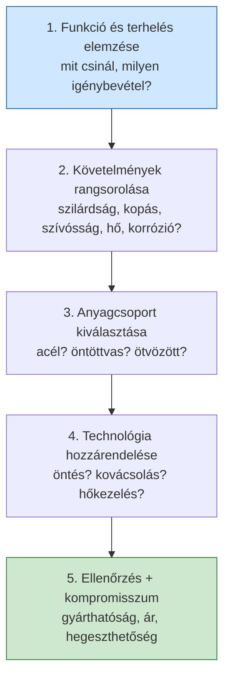

# 11. Anyag- és technológiaválasztás

[⬅️ Vissza a tartalomjegyzékhez](../README.md)

---

## 🎯 Mit kell tudni?

A tanár által kiemelt ⭐ **anyagválasztás menete** – a vizsgán kapsz egy **konkrét alkatrészt** (pl. kovácssüllyeszték), és le kell vezetned, milyen anyagot és technológiát választanál, **miért**.

---

## ⭐ Az anyagválasztás menete (TANÁR ÁLTAL KIEMELT KÉRDÉS!)

> A vizsgán adott alkatrészhez (pl. **kovácssüllyeszték**) kell anyagot választani. NEM a konkrét anyagnevet kérik elsősorban, hanem a **gondolatmenetet**!

### A módszer – 5 lépés

1. **Funkció és terhelés:** Mit kell tennie az alkatrésznek? Milyen igénybevétel éri? (statikus/dinamikus/lüktető, kopás, hő, korrózió, ütés.)
2. **Követelmények rangsorolása:** Melyik tulajdonság a **legfontosabb**? (pl. kopásállóság > szívósság, vagy fordítva.) Gyakran egymásnak ellentmondók (keménység ↔ szívósság) → kompromisszum.
3. **Anyagcsoport:** A követelmények alapján acél / ötvözött acél / öntöttvas / színesfém? Pl. kopás + ütés → nemesíthető, ötvözött szerszámacél.
4. **Technológia + hőkezelés:** Hogyan gyártjuk és milyen szövetet állítunk be? (öntés, kovácsolás, forgácsolás; majd edzés + megeresztés / nemesítés / betétedzés.)
5. **Ellenőrzés, kompromisszum:** Gyárthatóság, hegeszthetőség, ár, hozzáférhetőség. A választást **igazoljuk** a szövetszerkezet ↔ tulajdonság lánccal.

> 🔑 **A vizsgaválasz váza mindig:** *"Az alkatrészt X igénybevétel éri, ezért a legfontosabb tulajdonság Y, amit Z anyaggal és W hőkezeléssel érek el, mert a keletkező szövet (...) biztosítja Y-t."*

---

## 📝 Kidolgozott példa: KOVÁCSSÜLLYESZTÉK

> Ez a tanár által említett konkrét példa – tanuld meg mintaválaszként!

**1. Funkció és terhelés:**
A kovácssüllyeszték a meleg kovácsolás szerszáma: izzó (meleg) munkadarabot alakít, ismételt **ütésszerű (dinamikus) terhelés**, nagy **felületi nyomás**, **kopás** (a forró fém súrlódása), és **magas hőmérséklet** (hőfáradás, revésedés) éri.

**2. Követelmények rangsorolása:**
- nagy **melegkeménység** és **melegszilárdság** (ne lágyuljon el a forró daraboktól),
- jó **kopásállóság** (a vésetek sokáig megtartsák alakjukat),
- elegendő **szívósság/ütésállóság** (ne repedjen az ütésektől),
- **hőfáradás-állóság** (ciklikus felmelegedés-lehűlés).

**3. Anyagcsoport:**
**Melegalakító szerszámacél** (ötvözött). Jellemző ötvözők és szerepük:
- **Cr, Mo, W** → melegszilárdság, karbidképzés, átedzhetőség,
- **V** → finom karbidok, szemcsefinomítás (kopásállóság + szívósság).
- Közepes széntartalom (kemény, de ne legyen túl rideg). Tipikus képviselő: a **X37CrMoV5-1 / X40CrMoV5-1** (kb. a "W.-Nr. 1.2343/1.2344", ismert jelzés: **H11/H13** típusú melegmunka-szerszámacél).

**4. Technológia + hőkezelés:**
- Legyártás: kovácsolt/hengerelt előgyártmányból forgácsolással a véset kialakítása.
- **Nemesítés = edzés + megeresztés** (az edzés 3 feltétele, lásd 3. fejezet: elég szén, teljes ausztenitesítés, kritikusnál gyorsabb hűtés) → kemény, de kellően szívós martenzites/megeresztett szövet.
- A felületen esetleg **nitridálás** a kopás-/hőállóság növelésére.

**5. Ellenőrzés, kompromisszum:**
A keménység és szívósság ellentmond egymásnak → a **megeresztési hőmérséklettel** hangoljuk a kettő egyensúlyát. Ötvözött acél → jól **átedződik** nagy keresztmetszetben is (lásd 4. fejezet).

> 🔑 **A példa tanulsága:** nem az a lényeg, hogy fejből tudd a pontos anyagjelet, hanem hogy a **terhelés → tulajdonság → anyag + hőkezelés** láncot végig tudd vezetni és indokolni.

---

## 📝 Rövid minta-gondolatmenetek más alkatrészekhez

| Alkatrész | Fő igénybevétel | Választás (vázlat) |
|-----------|-----------------|--------------------|
| **Fogaskerék** | felületi kopás + mag szívósság | betétben edzhető (beedzésű) acél → **betétedzés** (kemény felület, szívós mag) |
| **Rugó** | ciklikus rugalmas | rugóacél (magas Si/Mn), nemesítve |
| **Motorblokk** | nyomás, rezgés, bonyolult alak | **öntöttvas** (szürke/gömbgrafitos) – jó önthetőség, rezgéscsillapítás |
| **Hegesztett tartószerkezet** | statikus teherbírás + hegeszthetőség | alacsony C-tartalmú szerkezeti acél (S235/S355) |
| **Csapágygolyó** | nagy felületi nyomás, kopás | nagy C-tartalmú, Cr-ötvözött, átedzett acél |

> 💡 **Visszatérő elvek:** (1) felületi kopás + szívós mag → **betétedzés**; (2) kopás + ütés, meleg → **nemesített ötvözött szerszámacél**; (3) bonyolult alak, nyomás → **öntöttvas**; (4) hegesztett szerkezet → **alacsony szén** (jó hegeszthetőség).

---

## ✅ Ellenőrző kérdések

1. ⭐ Sorold fel az anyagválasztás **5 lépését**!
2. ⭐ Milyen igénybevétel éri a kovácssüllyesztéket, és ebből milyen tulajdonságigény következik?
3. Milyen anyagcsoportot és hőkezelést választanál kovácssüllyesztékhez, és miért?
4. Miért betétedzést választunk fogaskerékhez?
5. Miért öntöttvas a motorblokk, nem acél?

🔎 Válaszok

1. (1) funkció/terhelés, (2) követelmények rangsorolása, (3) anyagcsoport, (4) technológia+hőkezelés, (5) ellenőrzés/kompromisszum.
2. Dinamikus ütés, nagy felületi nyomás, kopás, magas hőmérséklet → melegkeménység, kopásállóság, szívósság, hőfáradás-állóság.
3. Melegmunka-szerszámacél (Cr-Mo-V, pl. H13), nemesítve (edzés + megeresztés) – kemény, de szívós, jó melegszilárdság.
4. Kemény, kopásálló felület + szívós mag kombinációja (ütésálló mag, kopásálló felszín).
5. Bonyolult alak, jó önthetőség, jó rezgéscsillapítás, olcsóbb – az acél nehezebben önthető és drágább.

---

[⬅️ Előző](10-hegesztes-sajtolo.md) · [Vissza a tartalomjegyzékhez](../README.md)
